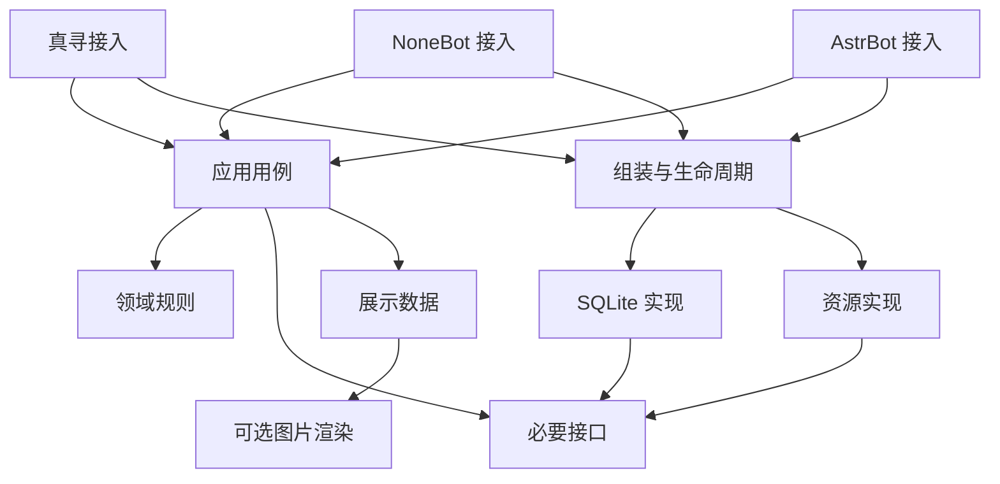

# 代码设计与目录

## 原则与当前状态

下列为建议设计，尚未实现。当前旧代码位于 legacy，未把其全局变量、
数据库管理器和服务定位器直接当作新核心继续复用。

采用一个共享 Python 包，内部按职责划分，避免先建多个互相依赖的
独立发行包。共享源码只维护一份；发布时复制进各插件私有目录。

## 目标结构

```text
farm/
  src/farm_core/
    domain/                 # 规则、值对象、状态转换，不做 I/O
    application/            # 注册/购买/播种等用例，拥有事务边界
    ports/                  # 必要的仓储事务、时钟、外部钱包契约
    infrastructure/
      sqlite/               # 连接、仓储、schema migration
      resources/            # 作物目录、资源校验与更新
    presentation/           # 框架无关展示数据；可选图片渲染
  integrations/
    zhenxun/                # 真寻命令、配置、金币、数据目录、生命周期
    nonebot/                # 普通 NoneBot 插件，不导入真寻
    astrbot/                # AstrBot 插件，不导入 NoneBot 或真寻
  assets/                   # 经整理、版本化的资源，尚未从 legacy 提取
  tests/
    unit/ integration/ contracts/ migrations/ packaging/
  release/                  # 构建目标、文件白名单、依赖与模板
  scripts/                  # 离线校验、迁移、未来打包工具
  legacy/                   # 旧实现参考；不进入新插件安装包
  docs/
```

本轮只创建职责说明及迁移基线，不生成大量空模块或假实现。
当一个用例实施时，才创建所需模块。

## 依赖方向



基础设施实现接口，由宿主启动阶段组装并注入；领域与应用代码不能
访问框架全局对象、事件、配置管理器或消息发送 API。
记录日志使用标准 logging，接入层按需桥接宿主日志。

## 每层的责任

| 层 | 应做 | 禁止混入 |
|---|---|---|
| 命令接入 | 参数解析、用户上下文、权限、确认、发送回复 | 再写一套价格/奖励计算 |
| 应用用例 | 业务校验、幂等、事务、调用领域计算 | 对聊天平台对象直接操作 |
| 领域规则 | 土地/星级/经验计算与状态转换 | SQL、网络、图片、框架导入 |
| 存储 | 条件更新、查询、schema 升级 | 命令文案、签到奖励选择、图片 |
| 展示 | 将结果渲染为文本/图片 | 修改余额和农场状态 |
| 资源 | 校验、版本、缓存与原子切换 | 未验证即覆盖线上目录 |

命令与业务服务返回明确结果，例如成功、余额不足、种子不足、
已处理、状态冲突；结果包含展示所需数值和错误码。
数据库故障不能转换成“没有记录”或“没有农场”。

## 最小接口建议

- UnitOfWork：一次用例获取同一事务下的仓储；成功才提交。
- Clock：提供带时区的当前时间，使跨日、成熟和签到可测试。
- PlantCatalog：提供带版本的作物定义，已种植实例绑定规则版本。
- ExternalWallet：仅在真寻金币等外部经济接入时启用，明确幂等与补偿。

不要为字符串工具、日志和每个函数都建接口。
领域对象使用明确数据类型，取代任意 dict[Any, Any]。
注册、库存、地块、货币、收获周期分别建模，枚举及字段有说明。

## 生命周期和异步模型

导入模块时不启动清理线程、不连接数据库、不发送网络请求。
宿主启动：验证配置→迁移→初始化仓储/资源→就绪；
宿主停止：拒绝新写入→等待在途用例→关闭连接和任务。

首期建议单进程嵌入式部署。不要用 threading.RLock 代替异步业务锁。
事务连接生命周期由 UnitOfWork 管理；即使使用进程内锁，SQL 仍需
条件更新和唯一约束。查询缓存首期可不做；需要时在提交后失效，
不缓存不存在的用户作为有效玩家，不把缓存余额作为扣款依据。

## 发布时的包隔离

src/farm_core 内部一律采用相对导入。
构建时复制为 <插件包>/_vendor/farm_core，接入层经包内路径导入。
_vendor 必须是普通包且顶层初始化无副作用。
禁止把共享核心作为全局同名 farm_core 安装后又在插件中带另一份，
避免同时安装真寻/NoneBot 包时导入碰撞。

第三方依赖只列核心必需项和当前接入层项；渲染依赖可选。
私有命名空间能隔离源码名称，不能隔离同一 Python 进程的第三方依赖
版本；冲突必须通过兼容测试或分进程解决。
