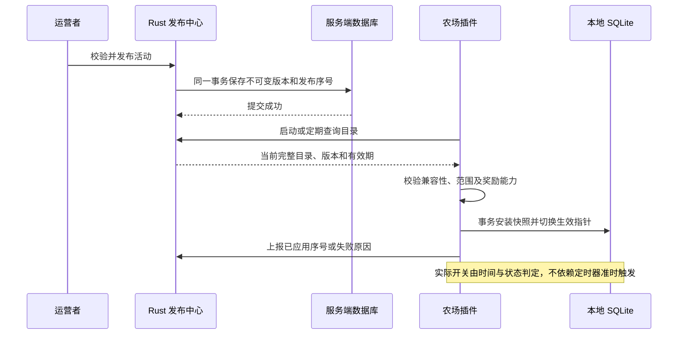

# 节日活动交互、Rust 服务端与上线事务规划

记录日期：2026-10-21。

状态：设计草案，供产品选择与后续实施使用；本轮仅编写文档。
本文没有表示 Rust 服务、同步协议、活动表或活动命令已经实现。
所有默认值均为建议，尚未进行负载、断网及真实 QQ 群验证。

## 1. 现状依据与设计边界

- 用户交接：农场已有播种、收获、仓库与偷菜等基础功能。
  151 项回归及后续 2 项相关测试的通过情况来自用户交接，本轮未重跑。
- 现有文档 `stealing.md` 描述 SQLite 事务、重放收据及版本 4；
  `18-web-panel-and-data-directory.md` 描述本地 `farm.sqlite3`。
  本轮阅读文档，没有据此宣称已核验当前源码及生产数据库。
- `AGENTS.md` 要求数据库保存权威状态，应用服务拥有事务边界，
  框架对象止于接入层；不修改 legacy 参考基线。
- `03-business-rules.md` 的身份隔离、幂等及外部资产设计属于已有建议，
  接入活动前仍需与实际身份模型、仓储接口及消息 ID 核对。
- 本轮开始时 `git status --short` 无输出；与此前未提交的交接状态不同，
  不推断此前改动如何处理，也不恢复、覆盖或提交其他内容。
- Rust 用于新增服务端，不将现有 Python 农场整体重写为 Rust。
  服务端建议独立仓库；本轮不创建服务工程或依赖占位文件。

## 2. 先决定服务端负责什么

| 方案 | Rust 服务负责 | 农场负责 | 主要代价 |
|---|---|---|---|
| A：活动发布中心，建议首期 | 配置、排期、发布、停用、同步状态 | 玩家进度、活动币、兑换、实际发奖 | 无全局共享余额；信任各部署 |
| B：集中活动账本 | A 的职责，加进度、活动币、限购与兑换单 | 上报事件、接收并入库奖励 | 网络依赖、事件防重、跨库交付与对账 |
| C：全部农场中心化 | 农场与活动全部权威业务 | QQ 指令与展示 | 数据迁移和可用性改造范围大 |

建议先做 A：上架活动不再要求发布插件，而玩家资产仍在原数据库事务内
变化。各机器人部署的活动资产独立，不宣称跨机器人共用，也不支持
全服限量兑换。若明确需要这两项能力，再采用 B。

信任边界：A 中部署管理员能够修改自己的 SQLite；服务端签名只能保护
发布配置，不能证明玩家行为真实。面向不受信任的第三方部署发放全服
稀缺奖励时，应重新评估 B 及事件可信来源，不能只接受客户端报来的数量。

## 3. 文字交互方案留档

### 3.1 五种可选方式

| 方案 | 示例 | 优点 | 限制 |
|---|---|---|---|
| 固定活动入口 | `农场活动`、`活动任务` | 学一次长期使用 | 多活动需明确目标 |
| 节日短名 | `万圣商店`、`端午任务` | 有主题感，便于并存 | 每期需展示入口 |
| 商品短编号 | `活动兑换 W1` | 不用输入复杂商品名 | 编号必须稳定 |
| 引用消息菜单 | 回复菜单发送 `2` | 新手不用背指令 | 需验证 QQ 引用消息能力 |
| 融入日常操作 | 收获额外掉落糖果 | 参与成本低 | 提示需节制，掉落需事务化 |

建议组合：固定入口 + 商品编号 + 日常玩法；节日短名作为快捷入口。
引用菜单为后续增强，不作为首期依赖，不监听群聊中的裸数字。

### 3.2 推荐命令

| 命令 | 行为 |
|---|---|
| `农场活动` | 列出可见活动、主活动进度和时间 |
| `活动任务` | 查看主活动任务 |
| `活动领奖` | 一次领取主活动全部已完成且未领取的任务奖励 |
| `活动商店` | 查看主活动商店、余额、限购 |
| `活动兑换 W1` | 兑换指定商品 1 份 |
| `活动兑换 W2 3` | 兑换指定商品 3 份 |
| `万圣商店` | 明确查看万圣活动 |
| `万圣兑换 W1` | 明确操作万圣活动 |

规则：

- 主活动由发布配置指定，同一部署同一时刻至多一个；不由玩家上次
  查看菜单决定。无主活动且存在多个候选时，仅提示可复制的明确指令。
- 商品编号在展示范围内唯一并绑定某期活动；不能只用每页第几项。
  例如本期为 `W26-1`，下一年不能把同一编号复用给另一件商品。
  示例 `W1` 是简写演示，正式编号策略需在首期冻结。
- 通用兑换可按唯一商品编号直接定位活动，不必重复活动名。
- 批量兑换必须全部满足余额和限购才成功；不静默缩减数量。
- 失败说明原因及下一条可执行指令；查询不发奖，消息发送失败不重复交易。
- 进入补兑期时，菜单显示“掉落已结束，兑换截止：北京时间某日某时”。
- 活动菜单默认文字；普通日常操作只在确有掉落、完成任务等变化时
  附带一行提示，不每次发送完整活动广告。

### 3.3 用户可见示例

```text
【万圣南瓜夜】
掉落截止：11 月 1 日 00:00（北京时间）
兑换截止：11 月 4 日 00:00（北京时间）
糖果：36；任务奖励：1 项可领取

收获作物有机会获得糖果。
查看任务：活动任务
领取奖励：活动领奖
查看商店：活动商店

W26-1 南瓜灯装饰  20 糖果  本期剩余 1
兑换：活动兑换 W26-1
```

上述日期和奖励仅为示例。没有实际可用装饰系统前，不上架装饰奖励；
首期可用已有种子、作物或内部货币，避免创建无效道具。

## 4. 农场如何知道活动上架了

### 4.1 推荐：主动拉取，通知只作加速



建议首期：启动同步一次，随后每 60 秒加随机抖动拉取；玩家访问活动
且快照过旧时触发一次共享刷新，避免每条消息各发一个请求。
网络请求不占用 SQLite 写事务，设置短超时并指数退避。

发布成功只表示服务端已提交；应分别展示“已发布、待客户端应用、
已应用、被拒绝、离线”。没有客户端确认时，不能显示全服上线成功。

### 4.2 目录响应与一致性

首期直接返回作用域内完整目录，规模小时比增量协议更容易正确处理删除。
目录至少覆盖预告、进行中、补兑和停用记录，不只返回正在进行的活动。

| 字段 | 实际用途 |
|---|---|
| `catalog_revision` | 单调递增的发布序号，拒绝乱序响应覆盖新状态 |
| `server_time` | 检查本机时钟偏差，辅助解释时间错误 |
| `valid_until` | 允许进行活动资产操作的快照授权截止时间 |
| `events` | 该部署当前可见的完整活动及不可变配置版本 |
| `revoked_instances` | 显式停用的活动实例，防止旧缓存继续启用 |

传输使用 HTTPS，部署身份由服务端凭据绑定，不能相信请求里的任意
`deployment_id`。支持 ETag/条件请求以降低开销，但 `304` 不自动延长
资产操作授权：有效期要通过可验证的新元数据或一次完整响应续期。
目录内容哈希用于检测损坏；若允许离线分发配置包，再加入签名与密钥轮换。

客户端先验证整个目录，再事务保存快照、撤销信息及生效序号；失败则
保留上个完整版本并上报错误，不先更新序号再下载失败。
目录为空表示确实没有活动，网络失败绝不能解释成空目录并清库。

离线展示可使用旧快照并标明更新时间；活动掉落、领奖和兑换必须同时
满足业务时间及授权有效期。建议首期授权最多 5 分钟，过期则暂停活动
资产操作，基础播种收获继续，且回复明确说明活动暂不可用。
这意味着断网跨过授权期限时不补发活动掉落；该取舍需在上线说明告知。

定时轮询加本地授权具有停用延迟：健康网络通常在一个轮询周期内，
断网时最多延续剩余授权时间，无法承诺瞬时全局停服。
若业务要求每笔兑换立即服从紧急停用，必须每笔在线授权或采用方案 B。

### 4.3 是否需要 WebSocket、SSE、Webhook

- 首期不需要长连接，轮询能穿过机器人所在机器的 NAT。
- 后期可加 SSE，通知仅携带“目录可能变化”，客户端仍重新拉取。
  断线后恢复轮询，不把消息送达当作业务提交或客户端已应用。
- Webhook 需要插件暴露可访问入口，不作为默认接入方式。
- PostgreSQL `LISTEN/NOTIFY` 可辅助唤醒服务内部工作者；它不是面向
  离线机器人的持久同步协议，发布记录仍必须入表。

PostgreSQL 官方说明通知面向已监听连接，事务中的通知在提交后交付；
因此本设计将数据库记录作为依据，通知只作提示。
来源：[PostgreSQL NOTIFY](https://www.postgresql.org/docs/current/sql-notify.html)。

## 5. 活动生命周期与时间

区分运营状态和按时间计算的玩家阶段，不存储互相矛盾的重复状态。

运营状态：草稿、已发布、暂停、撤销、归档。
玩家阶段由已发布状态和时间计算：

| 阶段 | 时间范围 | 允许行为 |
|---|---|---|
| 预告 | `visible_at <= now < starts_at` | 查看规则，不计进度、不领奖 |
| 进行中 | `starts_at <= now < ends_at` | 计进度、掉落、领奖和兑换 |
| 补兑期 | `ends_at <= now < redeem_until` | 只领取此前完成任务和兑换 |
| 已结束 | `now >= redeem_until` | 只查历史，不新建奖励交易 |

时间均存 UTC，文案按 Asia/Shanghai 展示；每日任务与限购按北京时间
日期分桶。采用左闭右开区间，恰好等于截止时间即不再接受新操作。

暂停：先统一暂停活动资产写入，保留查询；必要时恢复。
撤销：永久停止本期新操作，进入问题处理，不删除账本。
已经提交的奖励不因撤销自动收回；补偿与追缴必须形成独立审计操作。

计划排期预先下发到插件，本地在时间边界自然切换；定时工作者迟到不会
让活动多开放一天。重启后按当前时间重算，不依赖内存倒计时。
检测到明显时钟异常时停止活动资产操作并告警，不用旧授权无限续命。

## 6. Rust 服务端最小组成

建议一个服务进程加一个 PostgreSQL，先不引入 Redis、消息中间件或微服务。

| 模块 | 职责 |
|---|---|
| 管理 API | 草稿、校验、发布、暂停、撤销、查询发布情况 |
| 配置校验 | 时间、整数范围、商品编号、命令别名、规则与奖励能力 |
| 发布应用服务 | 比较预期版本、事务提交、生成发布审计 |
| 同步 API | 按部署返回目录、授予短期有效期、接收应用结果 |
| 后台工作者 | 扫描待处理维护任务、归档、清理和失败重试 |
| 存储与日志 | SQL 事务、迁移、备份、结构化文件日志和指标 |

技术候选为 Tokio + Axum + SQLx + PostgreSQL；实现时再锁定版本和最低
Rust 版本。Axum 用于 HTTP 路由与请求处理，SQLx 用于数据库事务；
库的回滚能力不能替代应用自行设计幂等和事务边界。
参考：[Axum](https://docs.rs/axum/latest/axum/)、
[SQLx Transaction](https://docs.rs/sqlx/latest/sqlx/struct.Transaction.html)。

首期允许使用管理 CLI 调用同一管理服务，不必先建设运营网页。
活动配置只允许受支持的声明式规则，不下发 Python/Rust 脚本、SQL、
模板执行表达式或可执行插件。不支持的新玩法需先升级农场能力。

## 7. 数据设计：每个概念必须参与业务

### 7.1 服务端发布数据（方案 A）

| 概念 | 必要内容及用途 |
|---|---|
| 活动实例 | `instance_id` 标识某年某期；名称、别名用于展示与解析 |
| 配置版本 | `revision`、规则、商品、时间、能力要求、哈希；发布后不可变 |
| 发布记录 | 当前版本、运营状态、目标部署、主活动标记、发布序号 |
| 部署应用结果 | 部署标识、已应用序号、能力集合、最近在线时间、失败码 |
| 操作审计 | 管理员、操作、前后版本、原因、时间；支持故障追溯 |

同一节日每年创建新实例，不修改去年实例来重复开服。
发布时检测同一作用域的主活动时间重叠、别名冲突和商品短编号冲突。
目标名单变更也增加发布序号；被移出范围的客户端必须收到撤销或完整
目录移除语义，不能继续使用无限期缓存。

### 7.2 农场本地数据（方案 A）

| 概念 | 必要内容及用途 |
|---|---|
| 活动快照 | 实例、版本、授权截止、配置正文；重启可恢复且可追溯 |
| 活动账户 | 玩家作用域、实例、余额；防止跨期花币 |
| 任务进度 | 玩家、实例、任务、日期桶、进度；永久任务不用日期桶 |
| 奖励领取记录 | 玩家、实例、任务、日期桶；唯一约束阻止重复领奖 |
| 兑换累计 | 玩家、实例、商品、限购周期桶、已兑换数量；事务限购 |
| 活动账本与收据 | 操作标识、请求摘要、版本、增减额、奖励结果、时间 |
| 日常行为去重 | 原业务操作与活动、规则的关联；避免重放重复掉落 |

玩家键复用实际农场身份范围，不只保存一个 QQ 号；实施时核对机器人、
平台与共享范围。余额和库存只存整数，明确上限并校验乘法溢出。
若已有账本和操作收据能表达这些用途，就扩展复用，不平行创建重复表。

不为首期添加无业务用途的排行榜、跨服积分、全服库存、邮件状态等字段。
快照版本用于解释交易，不能靠“当前最新配置”重算历史收据。

## 8. 发布与版本切换事务

### 8.1 上架步骤

1. 运营创建草稿，设定活动期、兑换期、范围、任务和奖励。
2. 校验时间关系、已有物品 ID、计量单位、上限、编号和能力要求。
3. 在测试部署预演规则，确认菜单中每条指令可执行。
4. 管理请求携带幂等键和预期版本；同键不同参数拒绝。
5. 在一个服务端事务内生成不可变配置版本、更新发布指针和目录序号、
   写入操作审计；失败整体回滚。
6. 提交后才响应发布成功。若以后加入可靠推送任务，其待发送记录也在
   同一事务写入；不要数据库成功后仅在内存里安排推送。
7. 插件获取目录并校验，在本地事务中安装版本；上报已应用序号。
8. 观察目标部署应用率、错误和时间，再扩大范围。

管理并发修改采用版本条件更新；两名管理员基于同一旧版本发布，至多
一个成功，另一个重新读取后操作。不能用最后写入覆盖来消除冲突。

### 8.2 热更新限制

- 文案可以新版本发布；已接受交易始终按其绑定版本结算。
- 活动币归属、任务语义和商品身份不在进行中重新定义。
- 首期建议活动开始后冻结价格、奖励、限购及掉落规则，避免旧快照
  在授权期内继续成交造成不公平；调整通过暂停、等待旧授权耗尽、
  发新版本、确认部署应用后恢复完成。
- 严重错误通过新发布序号回退到已知配置，不降低序号，不删除已发生交易。
- 本地交易对快照生效指针和授权有效期在写事务中检查；与同步切换
  串行化，不能在事务外读到旧配置后无限期继续写资产。

## 9. 方案 A：本地活动交易

### 9.1 收获掉落和任务进度

一次收获事务中：

1. 查原操作收据；已处理则返回原结果，不再次抽奖。
2. 读取活动快照，检查时间、范围、能力和授权；判定时刻在业务锁取得后
   采样，不能沿用排队前的旧时间。
3. 完成原有收获计算与状态更新。
4. 对符合条件的本次实际收获计算活动掉落，更新余额及任务进度。
5. 写入行为去重、活动流水及原操作完整收据，一起提交。

活动停用或授权失效属于正常“不参与活动”，不阻塞基础收获；活动
数据库写失败属于事务失败，不能吞掉异常后提交一半结果。
随机结果记录在已提交收据中。若事务回滚，重新计算不产生已到账的重复奖。
不默认让偷来的作物也触发收获掉落，以免改变现有偷菜事务和经济平衡；
如要支持，单独定义触发类型、计量方式并验证。

### 9.2 任务领奖

在一个事务内检查阶段、已完成进度和领取唯一约束，写领取记录、增加
奖励、写流水和收据，再提交。全部领取以事务内实际可领取集合为准，
并发请求最多领取一次。只查看任务不标记领取。

### 9.3 商店兑换

```text
BEGIN
  查幂等键与请求摘要，已成功则返回原收据
  校验快照、授权、时间、商品与正整数数量
  条件扣活动币：余额 >= 总价
  条件更新限购累计：已购 + 本次 <= 上限
  向现有种子/作物/内部货币仓储增加奖励
  写活动流水和兑换收据
COMMIT
提交后回复 QQ 消息
```

余额不足、限购失败或入库失败时整体回滚，不能只扣币。
任何底层仓储方法不能自行提交。网络与绘图不放进事务。
请求幂等键包含部署、机器人、平台、消息标识与动作命名空间；同键不同
参数拒绝。没有可靠消息 ID 时，需要持久化操作令牌，不能用每次新 UUID。

超时未知结果先查收据，不推断失败后再次扣款；已成功收据的查询不受
活动截止限制。永久奖励留在正常仓库，不能随活动账户清理一并删除。
首期不直接兑换真寻外部金币，以免重新引入跨库原子性问题。

## 10. 方案 B：若以后集中管理活动币

只有需要跨部署共用余额或全服库存时再实施；不能和 A 同时保留两个
可写活动余额。迁移必须暂停入口、结清待办、核对余额并切换唯一权威源。

### 10.1 日常事件可靠上报

- 农场在原收获事务中写业务结果和待上报事件（outbox），提交后发送。
- 服务端按部署和事件 ID 去重；验证已登记部署、规则、玩家范围和时间。
- 服务端同一事务写接收记录、更新进度/活动币、写账本。
- 客户端仅在收到可查询的成功结果后确认事件已交付；超时重试同 ID。
- 明确迟到事件政策：建议最多接受截止前已发生且在宽限期内收到的事件；
  事件时间只能来自受信部署，越过宽限期进入核查，不悄悄改变历史结算。
- 未到账进度显示“待同步”，不能拿尚未服务端确认的余额兑换。

### 10.2 中心扣币、农场入库不是一个事务

1. 服务端在一个事务内校验余额与限购，扣币、创建唯一奖励单和交付任务。
2. 农场轮询领取属于本部署的待交付奖励单，或用兑换响应取得该单。
3. 农场在一个本地事务内按 `grant_id` 去重、奖励入库、写入库收据。
4. 农场提交后确认，服务端把奖励单标记已交付。
5. 确认丢失则重发同一奖励单，农场返回已有收据，不二次入库。

玩家看到“兑换已受理，奖励待到账”，到账后才报告已入库。
这里保证的是重试与去重后业务效果一次，不承诺网络只传一次。
待交付任务以数据库为准，多工作者用数据库锁或租约认领并恢复超时任务。

**超时不能自动退款。** 本地可能已经入库，只是确认丢失。
退款需先通过本地持久化终态证明奖励未发放，并将该单永久标记为取消、
拒绝后续交付；无法建立此屏障则保持待核对，不同时退款和重发。
活动结束后仍交付截止前已受理奖励，不能清除尚未确认的交付单。

## 11. 如何清理过期活动

“不再展示”“停止写入”“兑换结束”“数据删除”是四个不同动作。
**建议自动关闭、延后归档、受控删除，而非到点整表删除。**

### 11.1 分阶段策略

| 时刻/条件 | 动作 | 保留内容 |
|---|---|---|
| 到掉落截止 | 停止新掉落和任务计数，进入补兑 | 余额、领奖资格、商店、流水 |
| 到兑换截止 | 停止新领奖和兑换，移出常用菜单 | 历史收据、旧配置、待核对操作 |
| 在途事务排空后 | 生成结算摘要；将剩余活动币记为过期 | 过期流水、总额、审计依据 |
| 建议结束后 30 天 | 归档活动，历史只读 | 配置与关键资产账本 |
| 满足保留策略后 | 分批删除可重建缓存和不再需要的明细 | 防重依据、待办、永久奖励 |

首期建议剩余活动币过期失效，不自动换基础币；这属于待确认的产品规则，
必须在活动开始前公示。若以后支持自动折算，按玩家生成唯一结算操作，
折算发奖和余额消耗同事务完成，不能靠重新扫描重复发放。

### 11.2 并发与崩溃恢复

- 截止判定在交易里执行，不靠清理任务更新一个布尔值后才停止。
- 对同一活动账户的兑换与过期结算串行化；取得锁后再次检查阶段。
  截止前已受理的事务可以完成，清理等待它们完成，不抢先清余额。
- 维护任务保存活动、阶段、游标、重试次数、最近错误；这些字段用于
  断点续跑和告警。多实例服务认领任务时使用数据库锁/租约。
- 每批小事务提交，不用一个长事务扫描所有玩家。
- 每个账户的过期结算有唯一操作标识；崩溃重跑返回既有结果。
- B 方案须等迟到事件窗口关闭、待交付奖励和退款核对完成后再结算；
  不能因已到日历上的归档日期就删除尚未解决的数据。

### 11.3 可以删什么，不能删什么

可以优先清理：旧菜单缓存、可重建展示快照、超过排障窗口的同步诊断。
未发布草稿可以按管理保留策略删除。

不能直接删：永久种子/作物/货币、未交付奖励、待对账交易、有效幂等依据、
被流水引用的规则版本。旧物品若已入仓，正常目录仍要能解释其 ID；
活动下架不能删除仍在使用的物品定义。

关键账本建议先按至少 180 天规划，再根据体量、隐私和运维需求确认；
该天数不是法律要求或既有承诺。幂等记录保留时间必须覆盖消息重放和
任务重试窗口。无法给重放窗口设上限时，保留紧凑的防重摘要，或永久
封存实例并拒绝它的新事件，不能只靠“清过了”防止重复发奖。

首期不开放活动硬删除接口。将来删除需提供预览数量、备份、引用检查、
操作审计及恢复演练。清理工作者无管理权限去删除整个农场数据库。

## 12. API 草案（首期 A）

以下是接口职责，不是已实现路由；具体 JSON 与错误码在开发设计中冻结。

| 接口 | 作用及事务要求 |
|---|---|
| `POST /admin/events` | 创建草稿 |
| `POST /admin/events/{id}/validate` | 校验草稿及目标能力，不上架 |
| `POST /admin/events/{id}/publish` | 幂等发布；预期版本冲突明确返回 |
| `POST /admin/events/{id}/pause` | 暂停并增加目录序号 |
| `POST /admin/events/{id}/revoke` | 撤销并保留审计与历史 |
| `GET /admin/events/{id}/rollout` | 查询目标部署的应用情况 |
| `GET /v1/event-catalog` | 按已认证部署取得完整目录 |
| `POST /v1/catalog-ack` | 上报应用序号、能力和失败原因 |

管理身份与插件身份分离，插件不能发布活动；限流、请求体大小和操作
数量有上限。客户端上报的版本确认只证明安装，不证明玩家奖励已正确到账。
A 不开放远程“给玩家改余额”接口，避免产生第二个资产写入口。

## 13. 上线与运营事务清单

### 13.1 首次部署 Rust 服务

1. 确定域名、HTTPS、访问凭据、目标部署范围和备份位置。
2. 建立数据库迁移及恢复流程，演练空库启动和失败回滚。
3. 先部署兼容旧插件的服务，新服务不要求旧插件立即支持活动。
4. 再发布带活动能力的插件；默认活动入口无可用配置时正常提示。
5. 校验服务身份、目录拉取、授权到期和撤销机制。
6. 在测试群演练完整活动生命周期，不能只检查管理 API 返回成功。

### 13.2 每次活动上架

- 先创建实例和草稿，核对时间、奖励可用性、经济产出和指令冲突。
- 预告阶段验证目标部署已应用；能力不足的部署显示未覆盖，不强行启用。
- 建议先一个测试部署，再小范围，再全量；发布范围由服务端确定。
- 观察活动指令失败率、同步滞后、兑换回滚、掉落总量和余额异常。
- 正式开始前备份；上线后抽查实际玩家操作、账本与库存结果一致。
- 本设计首期只在用户查询和正常操作中提示，不默认向所有 QQ 群群发公告。

### 13.3 日常巡检与告警

结构化文件日志记录：操作关联 ID、实例与版本、部署匿名标识、耗时、
阶段、错误码；不记录凭据、完整 QQ 事件或真实玩家信息。
业务账本可保存关联所需玩家键，但按最小权限访问，不能代替普通日志脱敏。

关键告警：目录同步超过授权窗口、客户端版本拒绝、兑换事务失败、
结算任务积压、重复事件激增、时钟异常；B 额外监控未交付奖励和对账单。
服务就绪检查涵盖数据库可用及迁移兼容，不只检查进程是否存在。

### 13.4 故障与回滚

| 故障 | 处理 |
|---|---|
| Rust 服务不可用 | 基础农场继续；授权过期后暂停活动资产操作 |
| 目录配置无效 | 拒绝整份更新，保留旧快照直至授权到期，上报原因 |
| 插件不识别玩法或奖励 | 标记该部署未应用，不加载一半规则 |
| 错价或异常产出 | 暂停，等待旧授权耗尽，核账，再发布修正版 |
| QQ 回复失败 | 查原收据再回复，不能重复扣币或发奖 |
| 清理任务中断 | 从游标与唯一结算记录恢复，不整表重置 |
| 新插件代码故障 | 停活动再回退兼容代码；不直接还原旧资产库 |

数据库备份恢复会让已发生交易的防重记录倒退，必须停写并对账，不能
把恢复数据库当作无损的代码回滚。迁移先做向后兼容的增量变更，确认
旧版本不能安全使用新结构时禁止直接降级运行。

## 14. 实施顺序与验收

| 阶段 | 实施范围 | 完成证据 |
|---|---|---|
| 1 | 冻结首期玩法、身份范围、配置协议、到期政策 | 规格与示例配置评审 |
| 2 | Rust 管理、校验、发布及完整目录 | 发布并发、回滚、认证测试 |
| 3 | 农场快照同步与生命周期，尚不发资产 | 重启、乱序、断网、撤销验证 |
| 4 | 本地掉落、领奖、兑换与账本 | 并发、重放、事务失败验证 |
| 5 | 过期结算、归档、运维指标 | 截止竞争、断点续跑、恢复演练 |
| 6 | 测试群及灰度活动 | 实际菜单、掉落、兑换、到账核对 |

必须覆盖的异常场景：

- 开始和结束的精确边界、北京时间零点、跨日限购、重启跨越截止时间。
- 同一消息并发重放、同一任务并发领奖、最后一份限购并发兑换。
- 扣币后入库失败、提交后回复失败、数据库提交结果未知。
- 发布后客户端掉线、旧授权未到期时紧急停用、乱序和空目录响应。
- 有效期到期时 `304`、下载失败、奖励 ID 不存在、旧插件能力不足。
- 清理过程中仍有交易、清理中断重启、历史收据重放、永久道具保留。
- 若选 B：事件迟到与重复、确认丢失、重复交付、退款与发货竞争。

这些为后续验收要求，本轮未新增测试文件或执行业务回归。

## 15. 建议默认值与待确认选择

| 决策 | 建议首期默认 | 何时需要调整 |
|---|---|---|
| 资产归属 | A：本地活动账户 | 跨部署共用余额、全服限量时选 B |
| 接入方式 | 60 秒轮询 + 抖动 | 对上线响应有更高要求时加 SSE |
| 离线授权 | 最长 5 分钟 | 需即时停用时逐笔在线授权 |
| 交互 | 固定入口 + 稳定编号 + 日常掉落 | 引用菜单能力验证后增强 |
| 首期玩法 | 收获掉落、累计任务、兑换已有物品 | 新玩法先发布客户端能力 |
| 价格与奖励 | 活动开始后冻结 | 先暂停并排空旧授权后改版 |
| 补兑期 | 掉落结束后再留 3 天 | 各期上架前确定并展示 |
| 剩余活动币 | 到期失效，不自动折算 | 如要折算需独立结算规格 |
| 到期处理 | 自动停止、延后归档，不硬删 | 运营保留策略确定后再实现删除 |
| 通知范围 | 用户主动查询与实际操作提示 | 群发需另行确定渠道与授权 |

以上建议未因生成本文而自动成为已批准的实现需求。
实施前最关键的选择是：是否确实需要“跨机器人共享活动资产”。
它决定采用本地事务即可完成的 A，还是需要跨库交付与对账的 B。

## 16. 本轮交付范围

- 新增本文及文档索引入口；未修改业务代码、legacy、版本文件或数据库。
- 阅读现有项目约定与相关设计文档，未进行结构性源码调用链调查。
- 外部资料仅用于核对 Rust 库职责和 PostgreSQL 通知语义；架构取舍为本文建议。
- 未实现或部署 Rust 服务、未重启机器人、未执行真实 QQ 群验证。
